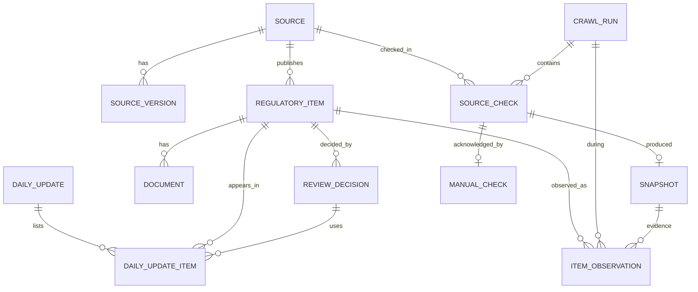

# Architecture — Regulatory Monitor POC (V1)

**Version:** 0.1 · **Date:** 21.11.2026 · **Read with:** `00-project-brief.md`, `01-PRD.md`, `02-tech-stack.md`

---

## 1. System context

```
 Compliance users (browser)
        │  HTTPS (TVS network)
        ▼
 ┌──────────────────────── FastAPI application (single process) ────────────────────────┐
 │  Static UI (HTML/CSS/JS)   API routers (/api/v1)   Services   APScheduler             │
 └───────────────┬───────────────────────────────┬───────────────────────────┬───────────┘
                 │ subprocess (per source)        │ SQLAlchemy                 │ files
                 ▼                                ▼                            ▼
        Scrapy crawler project            SQLite database               File store (data/)
        spiders · middlewares · pipelines  (Postgres later)              snapshots · documents · logs
                 │ HTTP (polite)
                 ▼
        Regulator websites: RBI (RSS + HTML) · UNSC (XML) · TRAI · IRDAI · eGazette
```

**Design rules**
1. Detection never depends on AI; it is deterministic (fingerprints).
2. Scrapy only fetches, snapshots and parses. Business logic (detection, review, email) lives in FastAPI services.
3. Scrapy runs as a **subprocess** — avoids event-loop conflicts with Uvicorn and isolates crashes.
4. No CAPTCHA/bot-check evasion. Blocked = recorded + manual path.
5. Nothing reaches the email without a human decision; the system never sends email.
6. Evidence is immutable and hashed; audit is append-only.

---

## 2. Components and responsibilities

| Component | Location | Responsibility |
|---|---|---|
| Static UI | `app/static/`, `app/templates/` | TVS-themed pages; call the API with `fetch`; no business logic |
| API routers | `app/api/` | Validate input (Pydantic), call services, return JSON |
| Review service | `app/services/review.py` | Decisions, bulk dismiss, manual upload, manual source checks |
| Detection service | `app/services/detection.py` | Fingerprints, change types, RSS-vs-HTML reconciliation, sanity checks, relevance scoring |
| Crawl runner | `app/services/crawl_runner.py` | Create run, launch Scrapy subprocess per source, collect status, call detection, lock against overlap |
| Scheduler | `app/services/scheduler.py` | APScheduler jobs from settings (10:00, 19:30, urgent hourly) |
| Email renderer | `app/services/email_render.py` | Jinja2 email (Outlook-safe), no-update variant, `.eml` export |
| Config service | `app/services/config.py` | Versioned sources/settings with approval workflow |
| Audit service | `app/services/audit.py` | Append audit events in the same transaction as each change |
| Repository layer | `app/repositories/` | `Repository` protocol; `memory` (mock) and `sql` implementations |
| Scrapy spiders | `crawler/regcrawler/spiders/` | `rss`, `listing` (config-driven HTML), `unsc_xml` |
| Middlewares | `crawler/regcrawler/middlewares.py` | Block detection (CAPTCHA/403/429/challenge/login) → BLOCKED, stop source |
| Pipelines | `crawler/regcrawler/pipelines.py` | Snapshot (SHA-256) → Normalise (URL, dates, ref no.) → DB write; FilesPipeline for documents |
| Text extraction | `app/services/documents.py` | PyMuPDF / pdfplumber; NEEDS_OCR flag |

---

## 3. Key interactions

### 3.1 Crawl cycle
```
Scheduler/RunNow ─► CrawlRunner.start(cycle)
   ├─ create crawl_run (status RUNNING), acquire lock
   ├─ for each active+approved source (sequential per host):
   │     spawn: scrapy crawl <spider> -a source=<id> -a run_id=<run>
   │        Spider → BlockDetectionMiddleware → SnapshotPipeline → NormalisePipeline → DbPipeline
   │        (raw ListingItems + snapshot rows + source_check status)
   │     record exit code / errors → source_check
   ├─ Detection.process(run): fingerprints → item / item_observation → reconcile channels
   │     → sanity checks → relevance scores → queue document downloads
   ├─ Documents.fetch(new items): download, hash, extract text, or NEEDS_MANUAL_FETCH
   └─ close run (status COMPLETED / PARTIAL), raise UI alerts, release lock
```

### 3.2 Review
```
UI Daily Review ─GET /items?cycle=…─► Review service ─► repository
Drawer Accept ─POST /items/{id}/decision─► Review service:
     validate → save review_decision (+ fields_edited) → item.state=DECIDED → audit_event (one transaction)
```

### 3.3 Email
```
UI Email Preview ─GET /daily-update/preview?cycle=…─► EmailRenderer (decided + include_in_update items)
Approve ─POST /daily-update/{id}/approve─► checks: approver role, failed sources acknowledged
Export ─GET /daily-update/{id}/export.eml─► unsent draft file → human sends from Outlook
```

### 3.4 Configuration change
```
Admin edit ─POST /sources/{id}/versions─► source_version(PENDING) + audit
Approver ─POST /sources/{id}/versions/{v}/approve─► (approver ≠ editor) → source updated, version APPROVED + audit
```

---

## 4. Data model



| Table | Key columns |
|---|---|
| `source` | id, authority, page_name, type (RSS/HTML_LIST/STRUCTURED_DATA/BROWSER), url, rss_url, adapter_config (JSON: selectors, date_format, pagination, filters), include_keywords, exclude_keywords, priority, requires_js, active, current_version |
| `source_version` | id, source_id, version, before (JSON), after (JSON), status (PENDING/APPROVED/REJECTED), requested_by, approved_by, ts |
| `crawl_run` | id, cycle_date, cycle (MORNING/EOD/ADHOC/URGENT), triggered_by, started_at, ended_at, status |
| `source_check` | id, run_id, source_id, channel, status (OK/FAILED/BLOCKED/PARSE_ERROR/ZERO_ITEMS), http_status, items_found, error_detail, snapshot_id |
| `snapshot` | id, source_id, channel, url, fetched_at, sha256, path — **append-only** |
| `regulatory_item` | id, internal_ref (TVSC-REG-YYYY-NNNNNN), source_id, fingerprint (unique), canonical_url, title, ref_no, displayed_date, channel (RSS/HTML/BOTH), channel_mismatch, relevance_score, relevance_reason, priority, state, first_seen_run_id, first_seen_at, last_seen_at |
| `item_observation` | id, item_id, run_id, channel, change_type (NEW/MODIFIED/BACKDATED/REAPPEARED), prior_hash, current_hash, snapshot_id |
| `document` | id, item_id, url, sha256, path, mime, text_path, fetch_status (OK/BLOCKED/FAILED/MANUAL), uploaded_by, fetched_at — **append-only** |
| `review_decision` | id, item_id, reviewer, decided_at, treatment, include_in_update, applicability, ref_no_and_date, authority, guideline_title, issue_date, publish_date, effective_date, status_colour, impact_text, sme_function, dismiss_reason, fields_edited (JSON) |
| `daily_update` | id, cycle_date, cycle, status (DRAFT/APPROVED/EXPORTED), subject, html, sources_ok, sources_failed, approved_by, approved_at |
| `daily_update_item` | update_id, item_id, decision_id, serial_no |
| `manual_check` | id, source_check_id, user, note, ts |
| `sme_function` · `recipient` · `email_template` · `setting` | Versioned configuration |
| `app_user` | id, name, email, role (viewer/reviewer/approver/admin) |
| `audit_event` | id, ts, actor, action, entity, entity_id, before (JSON), after (JSON) — **append-only** |

**Additions made in M1 (mock API, 23.11.2026)** — needed by the review and approval flows; the SQL models (Prompt 7) must carry them:
- `source.planned` (bool): on Compliance's monitoring list but not in the POC; always inactive.
- `source_version.decided_at`, `reject_reason`.
- `regulatory_item.summary`: one-line change summary (e.g. UNSC "alias added").
- `document.filename`: original name of a manual upload.
- `review_decision.is_draft`: "Save" keeps a draft; only Accept / Dismiss are final and can reach the email. `treatment` is empty only on a draft.
- `daily_update.prepared_by` (list of names, used for approver ≠ preparer) and `exported_at`.
- `setting.pending` (proposed value, requester, version): settings are versioned with maker–checker approval like sources.
- POC note (Prompt 6): SME routing, recipients and the email template are stored as versioned settings (`sme-routing`, `recipients`, `email-template`) so they follow the same approval and audit path. `SmeFunction`, `Recipient` and `EmailTemplate` are read-only views built from the approved value. A function cannot be deleted, only made inactive. Prompt 7 decides whether the SQL models keep this shape or use their own tables.
- One change per source or setting can wait for approval at a time. `GET /sources` and `GET /settings` return `can_edit`, `can_decide`, `decide_note` and a readable `pending_changes`/`changes` list for the current user.
- Enum values not listed above: `treatment` = INFO_ONLY · OTHER_FUNCTION · FUTURE_POTENTIAL · IMPLEMENTATION_REQUIRED · NOT_RELEVANT; `applicability` = YES · NO · TBC; `status_colour` = NOT_APPLICABLE · ACTION_OVER · IN_PROGRESS · NOT_AS_PER_PLAN · YET_TO_START; `source_check.channel` = RSS · HTML · XML; `item.state` also has ENRICHED (Luna, §7a).
- Cycle id on the wire: `YYYY-MM-DD-<CYCLE>`, e.g. `2026-11-20-EOD`.

**Built schema (Prompt 7):** `app/db/models.py` and migration `0001`; see `docs/data-model.md` (ER diagram, indexes, deviations) and `docs/postgres-migration.md`.

**Crawler writes (Prompt 9).** The Scrapy pipelines write only through the repository: `record_snapshot(snapshot, content, actor)` (row + write-once file + audit event in one transaction; refuses content whose SHA-256 differs), `add_raw_items(items, actor)` (one audit event per batch) and `record_source_check`. Raw rows go to the new table `raw_listing_item` (see `docs/data-model.md`, deviation 7); Detection turns them into items and observations.

**Integrity:** triggers reject UPDATE/DELETE on `snapshot`, `document`, `audit_event`; files written once to `data/snapshots/{source}/{date}/{sha256}` and `data/documents/{internal_ref}/{sha256}.{ext}`.

### Fingerprint and change rules
- `fingerprint = sha256(source_id + "|" + normalised_ref_no)` if ref no. exists, else `sha256(source_id + "|" + canonical_url)`.
- NEW: fingerprint unseen. MODIFIED: seen, title/content hash changed. BACKDATED: unseen and `displayed_date` < last successful run date. REAPPEARED: previously absent from listings for ≥1 run, now present.
- RSS-vs-HTML: same fingerprint in both → channel BOTH; otherwise `channel_mismatch = true`.

---

## 5. API structure (`/api/v1`)

| Method | Path | Purpose |
|---|---|---|
| GET | `/runs?date=` | List crawl runs |
| GET | `/runs/{id}` | Run detail + per-source checks (live progress) |
| POST | `/crawl/run` | Start ADHOC run (all or `source_id`) |
| POST | `/sources/{id}/test` | Dry-run one source; return parsed rows |
| GET | `/source-checks?cycle=` | Health strip data |
| POST | `/source-checks/{id}/manual-check` | Mark failed source checked manually |
| GET | `/items?cycle=&state=&channel=&q=&min_relevance=` | Review queue / search |
| GET | `/items/{id}` | Item + traceability chain |
| POST | `/items/{id}/decision` | Accept / save / dismiss |
| POST | `/items/bulk-dismiss` | Dismiss many with one reason |
| POST | `/items/{id}/upload` | Manual document upload |
| GET | `/daily-update/preview?cycle=` | Rendered HTML + data |
| POST | `/daily-update/{id}/reorder` | Set S.No order |
| POST | `/daily-update/{id}/approve` | Approve |
| GET | `/daily-update/{id}/export.eml` · `/export.html` | Export draft |
| GET | `/daily-update/cycle-export.csv?cycle=` | FR-32: every captured item of the cycle (incl. low relevance and dismissed), UTF-8 CSV for Excel, blank "Compliance marking" column |
| GET | `/source-health/grid` · `/source-health/compare?source_id=&cycle=` · `/source-health/checks/{id}/log` | FR-26: last four cycles per source and channel; RSS vs HTML comparison; check log |
| GET | `/snapshots/{id}/content` · `/documents/{id}/content` | Stored copy, shown as text only, served after its SHA-256 is re-checked (409 if it no longer matches) |
| GET | `/history/search?q=&authority=&from=&to=` · `/history/{item_id}/trail` · `/history/{item_id}/trail.csv` | FR-27: search all items; six-step evidence chain; chain as CSV |
| GET/POST | `/sources`, `/sources/{id}/versions`, `/sources/{id}/versions/{v}/approve|reject` | Register + approvals |
| GET | `/settings` · `/settings/{key}` | Settings (live value + any pending change) |
| PUT | `/settings/{key}` | Propose a value → pending (maker) |
| POST | `/settings/{key}/approve` · `/reject` | Approver ≠ requester (checker) |
| GET | `/sources/{id}/versions` | Version history with before/after |
| GET | `/sme-functions` | Active SME functions (id, name) for the review form |
| GET | `/audit?entity=&actor=&action=&from=&to=` · `/audit/view` (same filters; before/after as readable key/value rows and filter options) · `/audit/export.csv` | Audit (read only) |

Session helpers (POC): `GET /api/v1/me`, `GET /api/v1/users`, `GET /api/v1/health`; the header user switcher posts to `/switch-user` (cookie `poc_user`, hidden when `APP_ENV=prod`).
Error mapping: 403 wrong role or same person, 404 unknown id, 409 wrong state (e.g. unchecked failed source), 422 invalid input, 501 `/crawl/run` until Prompt 13.
Roles: reviewer/approver review and upload; admin/approver propose source and settings changes and test sources; only an approver approves, and never their own change or an update they prepared. Viewers read only.

Page routes (`/`, `/review`, `/health` (the Source health screen; JSON liveness is `/api/v1/health`), `/email`, `/history`, `/sources`, `/settings`, `/audit`, `/styleguide`) return Jinja2 shells; data loads via JS.

---

## 6. Repository structure

```
reg-monitor/
├─ CLAUDE.md
├─ docs/ (this file, brief, PRD, tech stack, data-model, probe & shadow reports)
├─ app/
│  ├─ main.py · cli.py
│  ├─ api/ (runs.py, items.py, sources.py, settings.py, daily_update.py, audit.py, pages.py)
│  ├─ services/ (crawl_runner, scheduler, detection, documents, review, email_render, config, audit)
│  ├─ repositories/ (base.py, memory.py, sql.py, factory.py)
│  ├─ db/ (models.py, session.py, migrations/)
│  ├─ schemas/ (Pydantic models)
│  ├─ templates/ (base.html, pages/*.html, email/daily_update.html)
│  └─ static/ (css/tokens.css, css/components.css, js/api.js, js/ui.js, js/pages/*.js, fonts/, img/)
├─ crawler/
│  ├─ scrapy.cfg
│  └─ regcrawler/ (settings.py, config.py, state.py, repo.py, items.py, middlewares.py, pipelines.py, spiders/{base,rss,listing,unsc_xml}.py)
├─ config/ (sources.yaml, settings.yaml)
├─ data/ (gitignored: reg_monitor.db, snapshots/, documents/, logs/)
└─ tests/ (unit/, api/, contract/, crawler/, fixtures/{rss,html,xml})
```

### Crawler foundation (Prompt 9)
- **Settings** (`crawler/regcrawler/settings.py`): robots.txt obeyed; User-Agent `TVSCredit-RegMonitor/0.1 (+<crawler.contact from config/settings.yaml>)`; AutoThrottle on; `DOWNLOAD_DELAY=2` with jitter off (Scrapy 2.20 `DOWNLOAD_DELAY_JITTER=0`, so no gap is shorter than 2 s); one request at a time per domain; timeout 30 s; retries (2) only for 500/502/503/504/522/524 and timeouts, never 403/429; cookies off; HTTP cache only with `REGCRAWLER_PROFILE=dev`; logs in `data/logs/`. Paths and the database are anchored to the repository root, and `REPO_BACKEND` defaults to `sql` in a crawl.
- **Spider arguments:** `-a source=<id> -a run_id=<id>`. The source is loaded from the database; an unknown or inactive source, or an unknown run, is refused. Spiders extend `BaseRegSpider` (`spiders/base.py`) and use Scrapy 2.13+ `async def start()`.
- **BlockDetectionMiddleware** (priority 560, after redirect/decompression, before retry): HTTP 401/403/429, a redirect into a login page, or a challenge page (markers in `config/settings.yaml` → `crawler.block_markers`, matched in the page title, or anywhere in a page under 32 KB) records the channel as `BLOCKED`, drops every later request for that source, and never retries. Nothing else is done. A false positive is visible (BLOCKED with a manual-fetch path) and never hides data.
- **Pipelines:** `SnapshotPipeline` (bytes → `data/snapshots/{source}/{date}/{sha256}`, snapshot row) → `NormalisePipeline` (`app/services/normalise.py`: canonical URL, ISO date, reference number, clean title; never drops a row) → `DbPipeline` (rows buffered, written with the `source_check` per channel when the spider closes: `OK`, `ZERO_ITEMS`, `BLOCKED`, `FAILED`). A channel never fetched after a block is `BLOCKED` too; one never fetched for another reason (e.g. robots.txt) is `FAILED`.

### Example source configuration (`config/sources.yaml`)
The real file is `config/sources.yaml` (Prompt 8). It stores the row/title/link/date selectors under `adapter_config.selectors` (the form on the Sources page writes the same shape), not flat as in the example below. Load it with `python -m app.cli import-sources config/sources.yaml --actor "<name>"`: it only proposes PENDING versions and is safe to run again.
```yaml
- id: rbi-notifications
  authority: RBI
  page_name: Notifications
  type: HTML_LIST
  url: <RBI notifications listing URL — confirm in probe>
  rss_url: https://rbi.org.in/notifications_rss.xml
  adapter_config:
    row: "<css selector>"
    title: "<css>"
    link: "<css>::attr(href)"
    date: "<css>"
    date_format: "%b %d, %Y"
    ref_no_regex: "RBI/\\d{4}-\\d{2}/\\d+"
    max_pages: 2
  include_keywords: [NBFC, non-banking, regulated entities, all lending institutions]
  exclude_keywords: [auction, variable rate repo, money market operations]
  priority: NORMAL
  requires_js: false
  active: true
```

---

## 7. Cross-cutting concerns

| Concern | Approach |
|---|---|
| Traceability | Chain: email row → review_decision → document (hash) → item_observation → snapshot (hash) → source_version → crawl_run |
| Security | Inside TVS network; `.env` for secrets; least-privilege file permissions; POC user switcher only in dev mode |
| Politeness | robots.txt, AutoThrottle, `DOWNLOAD_DELAY ≥ 2`, 1 concurrent request per domain, identifying UA |
| Observability | Structured JSON logs per run and per source; Scrapy logs under `data/logs/`; UI health strip and alerts |
| Error handling | One source failure never stops others; run status PARTIAL; failures surface in UI and email |
| Testing | Fixtures of real responses; no network in unit tests; contract tests for repositories; shadow comparison for acceptance |
| Configurability | Sources and settings are versioned data with approval; no code change for routine updates |

## 7a. Luna NBFC Screening Agent (added v0.2, 23.11.2026)
Advisory agent using **GPT Luna** (`gpt-6-luna`) behind `LlmClient` (`app/services/llm.py`), orchestrated by
`app/agents/orchestrator.py`, code in `app/agents/luna/`. Runs after detection/documents: screen → extract → sweep.
New tables: `ai_extraction` (append-only), `agent_flag`, `agent_run`. Item state may move to `ENRICHED`; never beyond.
New API: `POST /api/v1/items/{id}/agent` (Ask Luna), `GET /api/v1/agent/flags`, `GET/PUT /api/v1/settings/screening-guidance`.
Full spec: `docs/agents/luna-nbfc-agent.md`. Policies: `docs/constraints-and-policies.md` §3.

## 8. Extension points (V2+)
- `MailDraftService` → Microsoft Graph implementation.
- `AuthProvider` → Entra ID OIDC.
- `LlmClient` → AI enrichment with evidence-quote validation.
- `EmailAlertIngestor` → regulator email alerts from shared mailbox as a second channel.
- `regulatory_item` with `treatment = IMPLEMENTATION_REQUIRED` → Module 2 (implementation tracker) and per-circular OneDrive folders.
