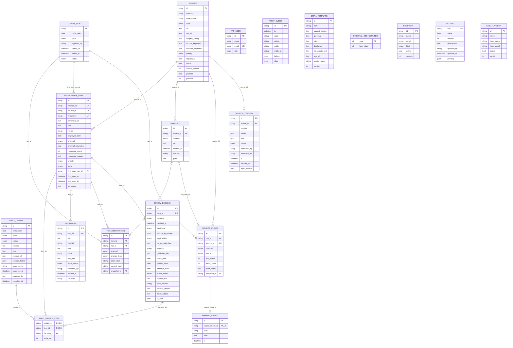

# Data model

The database schema of the Regulatory Monitor, as built in `app/db/models.py` (SQLAlchemy 2.0) and
created by the Alembic migrations in `app/db/migrations/`. The tables and columns follow
`docs/architecture.md` §4. SQLite is used for the POC; the models avoid anything SQLite-only so the
move to PostgreSQL is a configuration change (see `docs/postgres-migration.md`).

Build a fresh database with `.\tasks.ps1 migrate` (it reads `DATABASE_URL`, default
`sqlite:///data/reg_monitor.db`).

## Entity-relationship diagram

The diagram below is generated from the models. Refresh it with `python -m app.db.er --write`; a
test fails if it is out of date.

<!-- er:start (generated by python -m app.db.er --write; do not edit) -->

<!-- er:end -->

## Rules the database enforces

| Rule | How |
|---|---|
| Snapshots, documents and audit events are never changed or removed (CLAUDE.md rule 7) | `BEFORE UPDATE` and `BEFORE DELETE` triggers on `snapshot`, `document` and `audit_event` abort the statement. PostgreSQL also blocks `TRUNCATE`. |
| "New" is decided by fingerprint, not by a date (rule 6) | `regulatory_item.fingerprint` is unique. |
| Every item has a stable, human-readable reference | `regulatory_item.internal_ref` (`TVSC-REG-YYYY-NNNNNN`) is unique and comes from the `internal_ref_counter` table (below). |
| A source check is acknowledged at most once | `manual_check.source_check_id` is unique. |
| One check per source and channel in a run | unique `(run_id, source_id, channel)` on `source_check`. |
| One update per cycle | unique `(cycle_date, cycle)` on `daily_update`; unique `(update_id, serial_no)` on `daily_update_item`. |
| Only known values in coded columns | Enum columns are text with a `CHECK` constraint (no database-specific ENUM type). |
| Related rows exist | Foreign keys are enforced (`PRAGMA foreign_keys=ON` is set on every SQLite connection). |

## Indexes

| Index | Why |
|---|---|
| `regulatory_item.fingerprint` (unique) | "Have we seen this before?" on every crawl |
| `regulatory_item (source_id, first_seen_at)` | Listing items per source, newest first |
| `regulatory_item.state` | The review queue |
| `crawl_run.cycle_date` | Finding the runs of a cycle |
| Foreign keys used for look-ups (`source_check.run_id`, `review_decision.item_id`, …) | Joins |
| `audit_event (ts)`, `(actor)`, `(entity, entity_id)` | The audit log filters |

## Internal reference numbers

`TVSC-REG-YYYY-NNNNNN` is built by `app.db.refs.next_internal_ref(session, year)`. It runs one
`UPDATE internal_ref_counter SET last_value = last_value + 1 WHERE year = :year RETURNING last_value`.
The database serialises writers on that row, so two crawls cannot receive the same number, and the
increment is part of the caller's transaction, so a rolled-back item does not leave a gap. The first
reference of a year creates the counter row. A test runs many threads against a file database to
prove numbers are unique and gap-free.

## Values

- Keys are strings (36 characters). New rows get a UUID; the mock data's readable ids (for example
  `item-iors-faqs`) are also valid keys.
- JSON columns use the generic JSON type (`json` in PostgreSQL).
- Datetimes are timezone-aware and stored as UTC. `app.db.types.TZDateTime` returns the same instant
  on SQLite and PostgreSQL; a datetime without a timezone is refused.
- Dates (`cycle_date`, `displayed_date`, …) are plain dates.

## Deviations from architecture §4

Every table and column in §4 exists. These differences are deliberate:

1. **M1 additions are included.** The columns listed under "Additions made in M1" in §4
   (`source.planned`, `source_version.decided_at` / `reject_reason`, `regulatory_item.summary`,
   `document.filename`, `review_decision.is_draft`, `daily_update.prepared_by` / `exported_at`,
   `setting.pending`) are in the models, because the review and approval flows need them. Migration
   `0002` adds `source.position` (register order), which the SQL repository sorts sources by.
2. **New table `internal_ref_counter`** (`year`, `last_value`) for the reference generator.
3. **`sme_function`, `recipient` and `email_template` exist as tables, but the POC does not write
   to them.** Prompt 6 stores the approved SME routing, recipients and email wording as versioned
   rows in `setting` (`sme-routing`, `recipients`, `email-template`) so they share the
   approval and audit path. The tables are there because §4 lists them. **Open decision for the
   SQL repository (Prompt 8):** keep reading these three from `setting`, or write the tables on
   approval. **Decided in Prompt 8:** the SQL repository reads these three from `setting`, exactly
   like the in-memory one, so there is one source of truth and one approval path. The three tables
   stay empty and unused until a later migration removes them or a future need arises.
4. **Extra uniqueness rules** listed above (`manual_check`, `source_check`, `daily_update`,
   `daily_update_item`, `source_version (source_id, version)`, `app_user.email`). They state rules
   the services already apply; the database now refuses a violation.
5. **Nullable columns where the app needs it:** `document.sha256` (empty while a download is
   blocked), `review_decision.treatment` (empty only on a saved draft), `audit_event.before` /
   `after` (empty for creations).
6. **Plain-text columns for names that point at configuration** (`review_decision.sme_function`)
   have no foreign key, because the function list lives in `setting` (point 3).
7. **Relationship objects are not defined on the models.** Foreign keys and indexes are in place;
   the SQL repository queries them directly. Adding ORM relationships later does not change the
   schema.
